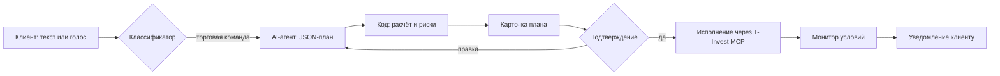
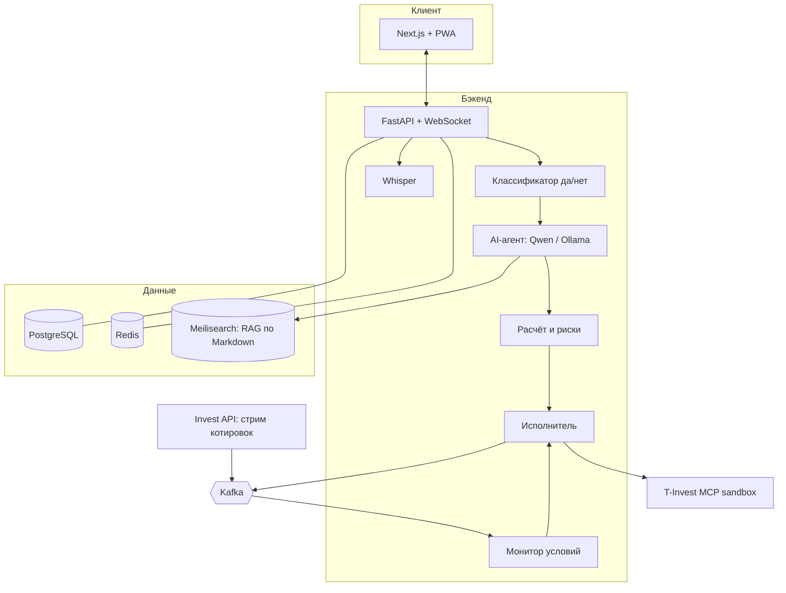

# Intent Agent

AI-агент, который превращает торговое намерение на обычном языке в проверенный план заявок, объясняет каждый шаг и исполняет его через T-Invest MCP после подтверждения клиента.

Концепция для программы «Инвест. Премаркет», трек «AI-агент».

> «Зафиксируй половину прибыли по Сберу, а если упадёт ниже 290 — продай всё»

**Страница проекта:** https://saaayurii.github.io/invest-intent-agent/

## Сценарий

AI понимает намерение и объясняет. Расчёт объёма, проверка рисков и выставление заявок — детерминированный код.

## Архитектура MVP

## Статус

Концепция и архитектура. MVP разрабатывается на этапе SYSTEM BUILD; все сделки выполняются в sandbox.

Не является инвестиционной рекомендацией.
